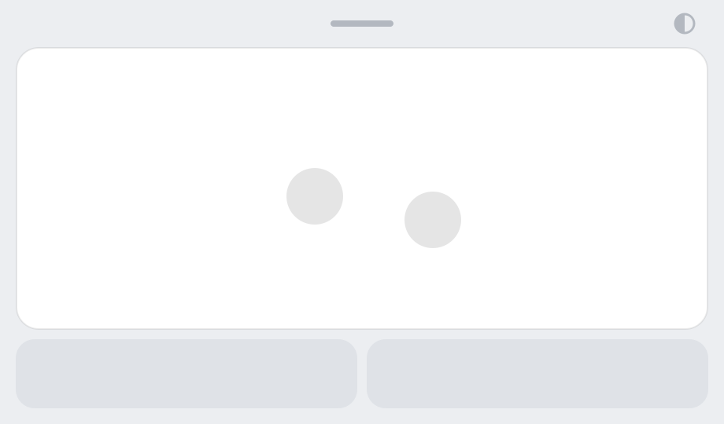
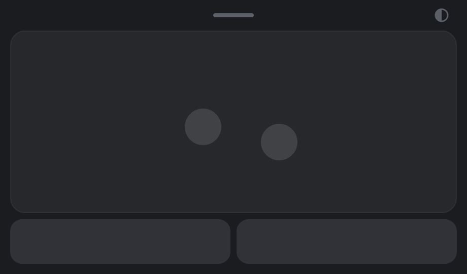

# V-Touchpad

An on-screen touchpad for Linux touchscreens. It puts a small floating window on your screen that behaves like a laptop touchpad, which is handy on 2-in-1s and tablets when the keyboard cover is detached or a precise pointer beats tapping with a finger.

<p align="center">
  
  
</p>

## Features

- **Real touchpad behaviour.** Your fingers are forwarded to a virtual touchpad, so the desktop handles it exactly like built-in hardware: pointer acceleration, tap to click, two-finger tap for right-click, smooth two-finger scrolling, pinch to zoom, three-finger swipes and tap-and-drag, all following your system touchpad settings.
- **Left and right buttons.** Hold one with one finger and move another finger on the pad to drag.
- **Stays out of the way.** The window floats above other windows and never takes keyboard focus away from the app you're using.
- **Light and dark mode** that follow your desktop. Tap the half-circle icon in the top bar to switch by hand.
- **Movable.** Drag the top bar (the one with the small handle) to move it.
- **Lives in the tray.** Show or hide the pad from its tray icon, and turn on *Start at login* to have it waiting in the tray after you log in. Closing the window asks whether to hide it to the tray or quit, and can remember your answer.

## Compatibility

| Desktop | Status |
| --- | --- |
| GNOME on Wayland | Tested (GNOME 50, Ubuntu) |
| GNOME on X11, KDE Plasma (X11 or Wayland) | Should work, untested |
| Sway, Hyprland and other tiling compositors | Pad works; staying on top and moving the window may need a window rule |

It needs a touchscreen, since the window only reacts to touch, and a desktop that uses libinput (all current major desktops do).

## Install

```sh
git clone <repository-url> v-touchpad
cd v-touchpad
./install.sh              # add --autostart to start it in the tray at login
```

The installer:

- installs the app for your user only (`~/.local/share/v-touchpad`, the `v-touchpad` command and an app-menu entry);
- asks for `sudo` once, to let your desktop user create virtual input devices (`/dev/uinput`) and to keep the pad working in tablet mode on 2-in-1s. Log out and back in afterwards.

Building the `python-evdev` library needs Python 3.10+, its headers and a C compiler. If something is missing, the installer prints the right package command for your distro, for example on Ubuntu:

```sh
sudo apt install python3-venv python3-dev gcc
```

To remove it: `./uninstall.sh` (add `--system` to also undo the `sudo` setup).

## Usage

Open **V-Touchpad** from the app menu, or run `v-touchpad`. Opening it again while it runs in the tray brings the pad back.

Clicking the tray icon shows or hides the pad. On Ubuntu's GNOME, the tray extension opens the menu on a single click instead, so double-click or middle-click the icon to show or hide the pad there.

The tray icon's menu has:

- **Show / Hide touchpad**
- **Start at login**: starts V-Touchpad in the tray (pad hidden) when you log in.
- **When closing the window**: *Ask every time*, *Hide to tray* or *Quit*. This is where you change a choice you told the close prompt to remember.
- **Quit**

On GNOME the tray needs the AppIndicator extension, which Ubuntu enables by default (elsewhere: [AppIndicator and KStatusNotifierItem Support](https://extensions.gnome.org/extension/615/appindicator-support/)). Without a tray, closing the window quits the app.

| Option | |
| --- | --- |
| `--speed 1.5` | Finger travel multiplier. 1.0 (default) makes the pad move the pointer like a real touchpad of the same size. Your desktop's touchpad speed setting applies too. |
| `--theme light\|dark` | Fixed colour scheme instead of following the desktop. |
| `--hidden` | Start in the tray without showing the pad. |
| `--debug` | Print the touch events the window receives. |

## How it works

V-Touchpad creates two virtual devices through the kernel's `uinput` interface:

- **V-Touchpad**, a multi-touch touchpad. Every finger on the pad is forwarded unchanged, so libinput and your desktop do all gesture recognition.
- **V-Touchpad Buttons**, a mouse that provides the left and right buttons.

A few desktop quirks are handled for you:

- **GNOME hides the cursor on every touchscreen touch**, and while it is hidden no app receives pointer clicks or scrolling. Before forwarding each touch, V-Touchpad sends a net-zero 1-pixel mouse motion, so the cursor stays visible and every event reaches the app under it.
- **GNOME ignores "always on top" for Wayland windows.** On a Wayland session V-Touchpad therefore runs through XWayland, where always-on-top and no-focus are honoured. Set `QT_QPA_PLATFORM=wayland` to run natively instead.
- **2-in-1s switch off touchpads in tablet mode.** The installer adds a libinput quirk (`ModelTabletModeNoSuspend`) that exempts V-Touchpad.

## Troubleshooting

- **"Cannot create virtual input devices"** in the window: `/dev/uinput` isn't writable. Run `./install.sh --system`, then log out and back in.
- **The pad does nothing in tablet mode:** the libinput quirk takes effect after logging out and back in.
- **Three-finger swipes:** GNOME Shell treats a three-finger swipe on the touchscreen itself as its own gesture, so it may act before V-Touchpad sees it (the result is the same workspace or overview switch).
- **Two-finger tap does nothing:** it follows the system *Tap to Click* setting (Settings → Mouse & Touchpad).

## Development

```sh
uv run v_touchpad.py --debug
```

[uv](https://docs.astral.sh/uv/) installs the dependencies from `pyproject.toml`. If building `evdev` fails with a missing `clang`, run `CC=gcc uv run v_touchpad.py`.

## License

[MIT](LICENSE) © 2026 Hamed
